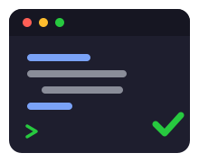

# ak

**English** · [Tiếng Việt](README.vi.md) · [日本語](README.ja.md)

Use one workflow across projects. Give `ak` a task and it takes it from understanding
through implementation, verification, and handoff. On first use it learns the relevant
repo setup and asks how you like to work. Future tasks reuse the same project form.

**[See the workflow demo and install commands](docs/catalog.html)** (Vietnamese)

## Get started

```bash
git clone https://github.com/vantrong2405/dev-workflow.git ak
cd ak
bash install.sh --codex
```

Pick the flag for your host. Use `--claude`, `--cursor`, `--codex`, or `--agy`.
Open your product repo and invoke `/ak` with a task, or select ak's start skill in
a host that uses a skill picker.

```text
/ak Fix the CSV export so it retains the selected filters
/ak TICKET-123 https://tracker.example/TICKET-123
/ak TICKET-123 Prepare for release --ship
/ak:vibe Add an order management screen for support staff
```

## What to expect

- **First task.** The agent reads relevant repo files, fills the project form and asks about
  conventions. Describe an example in your own words if that is easier. Confirm the proposed
  rules or skip the conversation to continue the task.
- **Later tasks.** The agent reads the relevant form entries and checks only the code and
  setup it needs. It asks when a decision changes the work or approval is required.
- **Handoff.** See the diff summary and evidence for what was checked. Request `--ship`
  to include release checks and applicable audit. Push, merge, and deploy require explicit authority.

Named commands, including `/ak:learning` for a targeted refresh and `/ak:status` for progress,
are also available. The checker and worklogs support manual operation and CI.

Use `/ak:vibe` for React and Next.js features that need a business diagram, a mockup, and
a reviewed plan before implementation. It uses the installed `diagram-design` skill and
renders PNGs from the included React/Tailwind templates. [Vibe conventions](references/vibe.md)

[Daily guide](docs/USER-GUIDE.md) · [Install and update](docs/INSTALL.md) · [Repository layout](STRUCTURE.md) · [Stage contract](references/stage-contract.md)

[MIT License](LICENSE)
