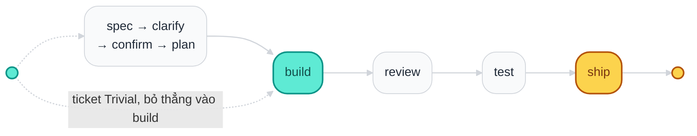

# ak

[](CHANGELOG.md)
[](LICENSE)
[](#cài-đặt)

[English](README.md) · **[Tiếng Việt](README.vi.md)** · [日本語](README.ja.md)

**Quy trình giao hàng AI đặt yêu cầu lên hàng đầu** cho Claude Code, Cursor, Codex, và Antigravity:
spec rõ ràng → con người xác nhận một lần → TDD → bằng chứng được máy xác minh → con người ký một
lần → ship.

## Tại sao

Không có quy trình gate, AI viết code thường:

- Bỏ sót business rule
- Ship bug UI/logic
- Đánh dấu "xong" mà không có bằng chứng
- Trôi khỏi những gì đã thực sự được xác nhận

ak chặn tiến trình cho tới khi các gate cấu trúc pass và **audit** ngữ nghĩa bắt buộc ký xác nhận.
Bộ kiểm tra (`bin/check-gates.sh`) là nguồn sự thật duy nhất — AI không được tự bịa ra PASS. Chỉ
**Risk P0** (tiền, quyền, PII, migration) hard-gate mọi bước; phần còn lại (P1/P2) dùng chung một
fast lane để ticket bình thường không phải gánh nghi thức không cần — xem [Gate & Risk](#gate--risk).

## Cài đặt

```bash
git clone https://github.com/vantrong2405/dev-workflow.git ak
cd ak
bash install.sh                          # global, Claude Code (mặc định) — xem docs/INSTALL.md cho Cursor/Codex/Antigravity
bash install.sh --path ~/projects/my-app # cài riêng trong project đó, không đụng global
bash install.sh --only spec,build,review # chỉ cài các stage đó, cả 2 mode
```

Sau đó trong bất kỳ project nào:

```text
/ak TICKET-123 https://tracker/TICKET-123
```

Lần chạy đầu tiên trong 1 project cũng seed/update `CLAUDE.md` của chính project đó (chỉ 1 khối có
đánh dấu — nội dung khác của bạn không bị đụng) với pipeline, quy tắc Risk, và convention trung
lập-stack (chia ngôn ngữ, diff tối thiểu, comment WHY không phải WHAT, không bao giờ force-push).
Đường dẫn cài đặt/cập nhật/gỡ đầy đủ theo từng host: [docs/INSTALL.md](./docs/INSTALL.md).

## Luồng

`:start` (cũng là alias trần `/ak`) là điểm vào duy nhất cho một ticket — phân tích một
lần, hỏi một lần, rồi chạy tới điểm dừng thật đầu tiên. `learning`/`coaching` khởi tạo hoặc sửa domain
knowledge độc lập, nằm ngoài pipeline này.



Giữa `review` và `ship`, `fix` chạy nếu còn phát hiện OPEN, `check` xác minh các gate, và `clean`
lưu trữ worklog sau đó — toàn bộ chuỗi và vai trò từng stage: [docs/USER-GUIDE.md
§3](./docs/USER-GUIDE.md#3-daily-flow-for-one-ticket). "Trivial" có định nghĩa chính xác (Risk=P2,
≤1 file, ≤5 dòng, không đổi định danh công khai, duplicate-scan sạch) — xem [docs/USER-GUIDE.md
§3.2](./docs/USER-GUIDE.md#32-start-a-ticket).

Một request dạng epic sẽ chạy qua `:decompose` trước, chia nó thành các ticket con rồi lặp lại chính
luồng này cho từng child một — xem [docs/USER-GUIDE.md](./docs/USER-GUIDE.md) để có sơ đồ đó và toàn
bộ hướng dẫn từng bước.

## Lệnh

**Mới dùng? Chỉ cần nhớ `/ak`.** Trong repo sản phẩm, mô tả việc cần làm và gọi `/ak` (có thể kèm mã ticket/link). Skill sẽ chọn các bước tiếp theo và dừng khi cần bạn quyết định. Các lệnh bên dưới chỉ cần khi bạn muốn chạy hoặc kiểm tra riêng một bước.

| Lệnh | Tác dụng |
|---------|--------|
| `/ak:spec` | AC có thể kiểm chứng + Risk tier (P0/P1/P2) |
| `/ak:clarify` | Đối chiếu spec/intent với hành vi hệ thống hiện tại; ghi lại quyết định |
| `/ak:confirm` | Con người ký xác nhận — điểm dừng duy nhất trước plan/build |
| `/ak:plan` / `:build` | Kế hoạch TDD + triển khai + bản đồ coverage |
| `/ak:review` / `:fix` | Review diff trung lập + triage/fix |
| `/ak:test` | Test thật + bằng chứng máy (SHA/CI/junit) |
| `/ak:check` | Chạy checker thật — không tự nhận PASS |
| `/ak:ship` | Checklist an toàn khi ship |
| `/ak:audit` | Kiểm tra sự nhất quán ngữ nghĩa — điểm ký xác nhận cuối trước khi ship là final |
| `/ak:decompose` | Chia epic thành ticket con, một lần confirm bao trọn cả split |
| `/ak:learning` / `:coaching` | Khởi tạo hoặc sửa domain knowledge của project |
| `/ak:status` / `:clean` | Ticket đang ở đâu / archive worklog đã xong |
| `/ak:feedback` | Báo bug của chính `ak` |
| `/ak:flow-diagram` | Tái hiện bug/UI-flow bằng sơ đồ plain-text, không hỏi lại giữa chừng |

Tham chiếu lệnh đầy đủ (cả 19 lệnh, tham số, và khi nào mỗi lệnh chạy độc lập):
[docs/USER-GUIDE.md §4](./docs/USER-GUIDE.md#4-commands-cheat-sheet).

## Gate & Risk

Mười gate cấu trúc cộng với một audit ngữ nghĩa thực thi luồng ở trên. Ba lane Risk quyết định một
ticket cần bao nhiêu nghi thức — **P0 là tier hard-gate duy nhất**; P1 và P2 dùng chung một fast
lane, nên một thay đổi hành vi bình thường không bị ép confirm giữa chừng như thay đổi
tiền/quyền/PII/migration. `/ak:confirm` và `/ak:audit` vẫn luôn là hai điểm con người thực sự quyết
định, bất kể tier. Định nghĩa có thẩm quyền nằm ở
[references/stage-contract.md](./references/stage-contract.md) và
[references/risk.md](./references/risk.md) — [docs/USER-GUIDE.md
§6](./docs/USER-GUIDE.md#6-gates-g0g9--audit-in-one-table) có bảng dành cho người đọc.

## Tìm hiểu thêm

| Tài liệu | Nội dung |
|-----|---------|
| **[docs/catalog.html](./docs/catalog.html)** | Catalog duyệt được của mọi Command/Skill/Reference/Template + trình tạo lệnh cài đặt (mở file này trong trình duyệt) |
| **[docs/USER-GUIDE.md](./docs/USER-GUIDE.md)** | Hướng dẫn hằng ngày đầy đủ: setup, luồng hằng ngày, câu confirm, tệp worklog, gate, pilot |
| [docs/INSTALL.md](./docs/INSTALL.md) | Cài đặt, cập nhật, gỡ, xác minh, đường dẫn theo host |
| [MARKETPLACE.md](./MARKETPLACE.md) | Cài đặt theo host cụ thể + smoke test |
| [STRUCTURE.md](./STRUCTURE.md) | Cây thư mục có chú thích |
| [references/vocabulary.md](./references/vocabulary.md) | Định nghĩa Command vs Skill vs Reference vs Template |
| [CONTRIBUTING.md](./CONTRIBUTING.md) | Cách thay đổi plugin |
| [CHANGELOG.md](./CHANGELOG.md) | Lịch sử phiên bản |
| [SECURITY.md](./SECURITY.md) | Báo cáo lỗ hổng bảo mật |
| [CODE_OF_CONDUCT.md](./CODE_OF_CONDUCT.md) | Quy tắc ứng xử cộng đồng |
| [references/](./references/) | Gate, risk, security, pilot, enforcement — cho AI + người dùng nâng cao |

## Giấy phép

[MIT](LICENSE)
