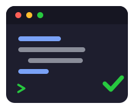

# ak

[English](README.md) · **Tiếng Việt** · [日本語](README.ja.md)

Dùng một workflow cho nhiều dự án. Giao việc cho `ak`, agent sẽ hiểu yêu cầu, sửa,
kiểm chứng và bàn giao. Khi gặp repo mới, agent đọc phần cần thiết và hỏi bạn muốn nó
làm việc thế nào. Các task sau dùng lại cùng một form dự án.

**[Xem demo và cách cài đặt ak](docs/catalog.html)**

## Bắt đầu

```bash
git clone https://github.com/vantrong2405/dev-workflow.git ak
cd ak
bash install.sh --codex
```

Chọn cờ cho host bạn dùng. Có `--claude`, `--cursor`, `--codex` và `--agy`.
Mở repo sản phẩm rồi gõ `/ak` kèm việc cần làm hoặc chọn skill start của ak nếu
host có danh sách skill.

```text
/ak Sửa export CSV để giữ lại bộ lọc đang chọn
/ak TICKET-123 https://tracker.example/TICKET-123
/ak TICKET-123 Chuẩn bị phát hành --ship
```

## Một luồng hằng ngày

- **Task đầu tiên.** Agent đọc repo, điền form và hỏi về quy ước. Bạn có thể kể một
  task thường làm bằng lời bình thường. Duyệt các rule agent tóm lại hoặc bỏ qua
  phần hỏi để tiếp tục task.
- **Task sau.** Agent lấy mục liên quan từ form và chỉ đọc code cần cho việc đang làm.
  Nó hỏi khi cần quyết định có ảnh hưởng hoặc cần bạn duyệt.
- **Bàn giao.** Bạn nhận tóm tắt thay đổi và bằng chứng kiểm tra. Dùng `--ship` khi
  muốn chuẩn bị phát hành và audit nếu áp dụng. Push, merge và deploy cần quyền rõ ràng.

Các lệnh riêng vẫn có sẵn khi cần, ví dụ `/ak:learning` để cập nhật một mục và
`/ak:status` để xem tiến độ. Checker và worklog dùng được cho thao tác thủ công và CI.

[Hướng dẫn sử dụng](docs/USER-GUIDE.vi.md) · [Cài đặt và cập nhật](docs/INSTALL.md) · [Cấu trúc repo](STRUCTURE.md) · [Hợp đồng các stage](references/stage-contract.md)

[Giấy phép MIT](LICENSE)
